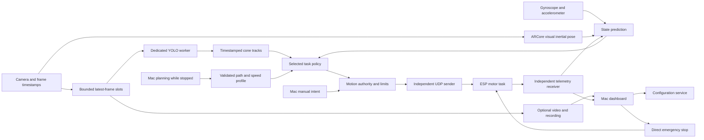

# MaxBot autonomy implementation plan

Status: reviewed implementation specification, with user decisions accepted on **2026-11-13**. This revision changes documentation only. Task 1 is the priority. Start implementation from the [GPT-6.1 Sol handoff](sol-implementation-handoff.md). Task 2 remains a documented follow-up: [brief implementation plan](training/implementation-plan.md) and [full training pipeline](policy-training-pipeline.md).

## 1. Agreed behavior and measurements

The Pixel 5 runs Android 14 and owns camera processing, YOLO cone detection, visual/inertial state estimation, and live task-policy execution. The ESP32 owns steering feedback control and motor PWM. The Mac computes the racing path and speed profile between runs and owns supervision, configuration, policy selection, manual controls, emergency stop, and run review. Both computers join the ESP32 access point. Normal operation uses Wi-Fi; temporary USB from the Mac to the ESP32 is available for firmware flashing.

| Accepted decision | Implementation consequence |
|---|---|
| Normal rear 1× camera first | Check mounted visibility and actual ARCore capabilities. Investigate ultrawide only if coverage fails. |
| Wi-Fi for Pixel–ESP control | Keep the transport abstraction. Consider a USB comparison only if measured delay/loss justifies it. |
| Mac plans between runs; Pixel drives | Generate and validate a complete reference while stopped. No Mac optimization or video round trip in the live driving loop. |
| 50 Hz initial phone feedback | Use actual monotonic elapsed time. Increase rate only after a controlled comparison demonstrates better tracking without worse deadlines. |
| Phone sends all motion commands | Mac manual intents use a phone control path independent of inference. Add a direct Mac→ESP emergency-stop channel, with no direct Mac driving. |
| Temporary USB flashing is possible | Flash and verify firmware while stopped, then remove the cable for driving. OTA is not a prerequisite for task 1. |

Opening the phone app automatically loads the last valid settings, connects, warms perception, and publishes status. Its UI contains status indicators only, with no application buttons or editable inputs. The operating sequence is **scout → stop/disarm → Mac plans → manual reposition → verify → timed run → finish crossing → controlled stop**. Retain the phone's localization session during repositioning. The timed slalom passes the car to the **right of cone 1**, then left, right, left. Scout along a conservative corridor on one side of the row; scouting does not need to weave between cones. Reconnection never starts or resumes motion.

| Property | Confirmed value / interpretation |
|---|---|
| Wheelbase / full width | 0.173 m / 0.144 m |
| Front / rear overhang | 0.03894 m / 0.055 m; rear value supplied in this conversation |
| Wheel steering | −26° right, +26° left; positive angles turn left |
| Camera location | Rear-axle origin: forward 0.06094 m, left 0.05090 m, up 0.09924 m |
| Cones | Four bright-orange cones, diameter 0.200 m, height 0.150 m |
| Cone spacing | **0.500 m edge to edge**, therefore 0.700 m center to center |
| Launch distance | Front bumper to the first cone's nearest edge: 1.000 m |
| Environment | Large indoor hallway, yellowish textured wood, indoor lighting; no nearby obstacles reported |
| Data collection | Robot's own camera, IMU, commands and telemetry; optional external slow-motion validation |

With the starting rear axle at `(0,0)` and the cone row along `+x`, the nominal centers are `(1.31194,0)`, `(2.01194,0)`, `(2.71194,0)`, `(3.41194,0)` meters. These follow from `0.173 + 0.03894 + 1.000 + 0.100`, then 0.700 m increments. Use these as course priors; scout observations establish actual locations and uncertainty.

Remaining measurements: camera pitch/yaw and confirmation that the mount matches the saved offsets; actual usable hallway width and finish stopping area; loaded steering dynamics; PWM/speed, acceleration, braking and grip. Cone base diameter must describe the entire collision footprint; verify whether any square flange extends beyond the reported 200 mm. These do not require repeating the already successful direction and steering-table calibration. The user's working hardware takes precedence over stale documentation, but an unknown dynamics measurement must not be invented.

The saved calibration still contains false commissioning flags despite working steering and traction. Reconcile those records explicitly during implementation. A verified direction or electrical brake does not itself measure floor stopping distance. Preserve the user's disabled battery monitoring and absent physical stop switch; neither is a reason to introduce a new sensor requirement.

## 2. What exists and what needs changing

Primary local references: [saved calibration](../../firmware/calibration/calibration.json), [geometry evidence](../../firmware/calibration/geometry-measurements.json), [parameter definitions](../calibration-parameters.md), [ESP runtime](../../firmware/maxbot/maxbot.ino), [phone orchestration](../../robot/android/maxbot/src/main/java/org/maxbot/app/MaxBotActivity.java), and [current trajectory planner](../../robot/android/maxbot-core/src/main/java/org/maxbot/core/Trajectory.java). Older 2S/GPIO14/provisional-angle descriptions are superseded by the latest calibration and hardware updates.

| Existing implementation | Keep / change |
|---|---|
| `firmware/calibration/calibration.json` | Keep the measured ADC table, motor polarities, gains, starting PWM and power mapping. Add confirmed geometry through a deliberate configuration migration later. |
| `firmware/maxbot/maxbot.ino` | Keep authentication, stop latch, calibration identity and motor mapping. Enforce absolute motion expiry in a separate nominal 200 Hz motor task; add application timestamps and an independent operator stop channel. |
| `maxbot-core/LatestFramePool.java` | Keep bounded, reference-counted, newest-frame semantics. Test the inference wakeup handoff so a pending frame is consumed promptly after a worker finishes. |
| `maxbot/ConeDetector.java` | Currently accepts only YOLOv5 `[1,320,320,3] -> [1,6300,6]`. Introduce model adapters and metadata; a newer YOLO file is not a compatible drop-in replacement. |
| `maxbot/ArCamera.java` | Keep one camera owner and ARCore VIO initially. Replace callback-derived timestamp alignment and slow Java plane copying. |
| `maxbot/MaxBotActivity.java` | Replace its large collection of controls with status-only presentation. Extract lifecycle, configuration, recording, links, metrics and control orchestration. It currently does not connect automatically. |
| `maxbot-core/RunSupervisor.java` | Preserve motion/stop authority. Move policy execution outside its shared monitor; add right-first task configuration and timestamped state snapshots. |
| `maxbot-core/Trajectory.java` | Become the reference-trajectory representation/validator and follower support. Put full-course optimization on the Mac. |
| `maxbot/NativeMpc.java` and native solver | Retain as a later comparison. Separate native image preprocessing from `mpc_jni.c`/solver loading so making MPC optional cannot break YOLO input preparation. |
| `controller/node-js/maxbot` | Extend the existing local console, rather than introducing another web stack. Add remote settings/model management, policy selector, direct ESP stop and latency views. |
| `tools/maxbot/{dataset,train}.py` | Reuse collection/provenance ideas. The current trainer is pinned to YOLOv5 v7.0 and needs a versioned adapter for a newer model. Task 2 remains a plan. |

The current `command_latency_ms` measures the latest detection's age when the phone sends commands. It repeatedly samples the same frame, does not identify its first applied command, and excludes ESP application and motor movement. `inference_ms` wraps preprocessing and postprocessing as well as model execution. Treat these as diagnostic timings, not measured camera-to-motor latency.

Additional review findings to resolve before autonomous floor trials:

- `ConeDetector` projects a box-bottom pixel to the floor; that may identify the visible base rim rather than the cone center. `CourseMap` then treats the result as a center. Correct this measurement model and its uncertainty before using it for collision clearance.
- Firmware validates the 100 ms TTL on receipt, then traction can remain active until the reception-based 150 ms watchdog. A delayed packet must not gain another full lifetime after arrival. Continuous motor-task deadline enforcement is required.
- A map-confirmation count and low residual scatter do not prove geometric accuracy; repeated views can share the same pitch/base-point bias. Validate against measured geometry and independent viewpoints.
- An empty detector result, a cone leaving the field of view, and stale localization are different events. Track them separately so the finish and close passes work correctly.
- The previous 25–90 ms capture-to-PWM estimate was an unsupported engineering hypothesis. It is withdrawn as an expected performance range. Establish stage budgets from the actual device baseline.
- The checked-in firmware has no OTA updater. Temporary USB flashing resolves initial deployment; do not turn OTA development into an extra task-1 dependency.

The runtime ESP loop is cooperative: serial/UDP processing, HMAC, telemetry and a 5 ms polling condition share the Arduino loop. It is not an independent fixed-deadline motor task. The calibration sketch already demonstrates the separate-task approach. Preserve controller behavior while separating scheduling; the bench and runtime PID formulations currently differ, so transfer of gains must be verified rather than silently changing the control law.

The repository contains substantial existing uncommitted MaxBot work. Implement this plan through scoped changes that preserve it; do not reset the workspace or replace generated calibration to obtain a clean starting point.

## 3. Recommended YOLO and runtime

**First challenger: one-class YOLO26n, 320×320, batch 1, exported to LiteRT, with FP16 weights and floating-point I/O on the GPU.** Establish the existing YOLOv5n adapter's baseline first. YOLO26's lighter DFL-free head and optional NMS-free path justify evaluating it, but do not establish a Pixel 5 winner. Published desktop CPU or TensorRT timings are not phone latency results. [Ultralytics YOLO26](https://docs.ultralytics.com/models/yolo26/)

Use a bounded benchmark sequence on the same labeled development footage:

| Candidate | Purpose |
|---|---|
| Existing YOLOv5n, 320 | Compatible baseline; record artifact availability rather than assuming trained weights exist. |
| YOLO26n, 320, GPU FP16 | Main challenger; inspect export compatibility and actual delegate assignment, including selection operators. |
| YOLO26n, 320, CPU INT8 | Test if GPU/VIO contention or delegation makes it relevant. Start with 1–2 CPU threads. |
| YOLO11n, 320 | Fallback investigation if the first challenger fails compatibility, accuracy or sustained timing. Not a mandatory additional benchmark matrix. |

Only test 256 input after 320 establishes reliable cone detection at the actual mount and distances. Consider 416 only if distant-cone/base localization requires it. Choose the smallest configuration meeting cone recall and geometric error requirements under full load; COCO mAP alone is insufficient. Do not make a large YOLO model the default for four cones.

Check the exported graph, actual delegate assignment, preprocessing, output decoding and sustained temperature. Split CPU/GPU execution can cost more than CPU-only inference. Integer I/O on the GPU also adds conversions because that backend executes floating-point operations. These are reasons to compare **GPU FP16 with float I/O** against **CPU INT8**, rather than assuming INT8 wins everywhere. [Google GPU delegate guidance](https://developers.google.com/edge/litert/performance/gpu)

Initialize, invoke, and close the GPU delegate on the same dedicated inference thread. Keep an explicitly supported CPU fallback; switching backend or model stops autonomy and requires a fresh start. Pin runtime/exporter versions and record them with the artifact. Current Ultralytics documentation uses `format="litert"` for new exports, still producing `.tflite` files; validate operator compatibility with the selected Android runtime rather than upgrading libraries blindly. [Android GPU usage](https://developers.google.com/edge/litert/android/gpu), [LiteRT export](https://docs.ultralytics.com/integrations/litert/)

Each model ships with a JSON manifest: hash, model family/exporter version, class mapping, tensor shapes/types, normalization, letterbox/rotation convention, quantization metadata, decoder type, whether NMS is required, and evaluation results. Output is `ConeImageObservation(frameId, captureTime, box, confidence, optionalBaseFeatures)`. A geometry/tracking component produces estimated ground centers and empirical uncertainty from these observations. Bounding boxes alone do not establish metric centers or covariance. Annotated video is produced separately; policies consume numeric observations and estimated state.

For task 1 implementation, assume a detector provides numeric observations through this interface. Replay fixtures may exercise the software without trained weights, but must be visibly isolated from live operation. Physical autonomous trials require a validated real cone model. First-model acquisition/fine-tuning remains documented in task 2; do not describe software integration as a completed autonomous demonstration when this dependency is missing.

### Camera choice and mounted-view validation

Use the normal rear 1× camera as the accepted baseline. Its larger pixels and wider aperture are favorable starting characteristics for the indoor hallway, while a narrower view gives more pixels per cone at a fixed model input size. Ultrawide can improve side coverage, but requires a measured benefit and its own calibration. The stock Camera app's available lenses/zoom positions do not establish which streams ARCore exposes. Enumerate `getSupportedCameraConfigs`, record `getCameraId`, stream dimensions and FPS, and verify the selected physical view. [Pixel 5 specifications](https://support.google.com/pixelphone/answer/16043605?hl=en), [ARCore configurations](https://developers.google.com/ar/develop/java/camera-configs), [camera identifiers](https://developers.google.com/ar/reference/java/com/google/ar/core/CameraConfig)

POV images from the mounted launch position and a representative close pass are useful for framing, body occlusion, floor texture, reflections and cone size. Matching ultrawide images are optional if coverage is problematic. Photos from the stock app are framing evidence, not exact calibration for an ARCore CPU stream with a different crop, distortion correction or exposure pipeline. Obtain actual-stream frames/metadata during implementation. Missing photos do not block host-side implementation.

Calibration identity includes camera/lens ID, image dimensions, orientation, crop/intrinsics convention and camera-to-vehicle transform. Use the intrinsics for the actual CPU image, with consistent distortion treatment. Never substitute advertised field-of-view angles for calibration or reuse another lens's extrinsics. The saved lens offsets are priors until matched to the selected normal-camera stream.

At the saved height `h = 0.09924 m`, the simple ground-range model `d = h / tan(alpha)` has sensitivity `abs(dd/dalpha) = (d² + h²) / h`. At 3 m, a 0.5° angular error gives about 0.79 m first-order range error. This is an illustrative sensitivity calculation, not a measured error. Reject ill-conditioned or clipped ground intersections; use close/multiple views, calibrated base geometry, VIO baselines and a robust fit to the measured row spacing. The visible base rim is not automatically the cone center. Nominal row geometry remains a prior, with independently observed checks before map confirmation.

## 4. Independent data paths on the phone



Start with these rates as configurable hypotheses:

| Work | Scheduling and overload behavior |
|---|---|
| Camera / VIO | Existing supported 640×480/30 configuration first; investigate 60 fps only if supported with the required streams and better under full load. |
| IMU | Approximately 200 Hz, unbatched delivery where supported, its own handler thread and bounded history. |
| Detector | One invocation at a time; always take the newest pending frame. Effective rate is measured, not forced by queueing. |
| State prediction / policy | **50 Hz initial feedback**, using actual elapsed time. Predict state to expected application time. Raise the rate only if tracking/deadline measurements justify it. |
| ESP command I/O | Independent TX and RX paths, initially 50 Hz then 100 Hz if full-load measurements justify it. Latest output replaces older pending output. |
| ESP steering / protection | Dedicated nominal 200 Hz task with deadline and overrun counters. |
| MCU telemetry | 50 Hz initial baseline; test 100 Hz when needed for measurement. Critical applied-command events have their own bounded ring. |
| Mac telemetry / video | Metrics around 10 Hz; optional hardware-encoded video around 10–15 fps with a configurable bitrate cap. |

Use immutable snapshots or double buffers between stages. Never hold a supervisor lock while running a solver, authenticating packets, sending sockets, writing JSON, rendering the UI or recording. TX/RX threads must not wait for inference or the dashboard. Commands carry source-frame/state identifiers and their freshness; a fast sender must not keep renewing an old perception decision indefinitely. Any independently permitted prediction window is bounded and logged.

Publish a completed policy output directly to the independent sender so another periodic TX phase does not add an unnecessary 20 ms wait. Keep bounded rate limiting and command deadlines. Inference completing just after a policy tick can still incur almost 20 ms before the next 50 Hz update; include that phase in measurements. Do not conceal it by assuming that inference, policy and transmission are synchronized.

Replace the per-pixel Java YUV copy with stride-correct native plane processing, ideally combining crop, resize, YUV-to-RGB and normalization into one pass. Reuse direct buffers and fixed-size detection storage. Treat zero-copy GPU interop as a later measured optimization, since camera ownership, GL contexts and VIO introduce constraints. A status-only app may still require a hidden/internal rendering surface for ARCore; VIO must not stop when the camera preview is removed.

Video and recording currently receive frames after detector processing in the inference job. Fan them out independently through owned bounded buffers, with lower priority. Saturated encoders/storage may drop optional frames; they may not delay control. Record every control/stop event when storage permits and explicitly count any event loss.

Use Android thread priorities carefully and profile scheduler/GC behavior. CPU thread count is a tuning variable; assigning all cores to inference can delay network and sensor work. Avoid root, fixed CPU affinity, and disabling thermal protection. Shed optional video/recording first; stop autonomy if essential state or control deadlines are no longer met.

## 5. Wi-Fi transport, discovery, manual drive and stop

The ESP remains the access point at its configured local address. Bind phone sockets to that Wi-Fi network so a network without Internet access does not accidentally send traffic over cellular. Verify phone-to-Mac peer connectivity through the AP. No public STUN/TURN or cloud service is required.

Avoid hardcoding a Mac DHCP address into each APK. Add a small authenticated discovery/registration endpoint on the ESP: the Mac registers its dashboard endpoint with a boot-bound expiring lease, and the phone queries it at the known AP address. The registry accepts only same-subnet addresses derived/validated against the registering peer. A cached endpoint is a fallback, never proof of authority. Endpoint changes affect connections only while stopped.

Keep authenticated UDP for motor commands and telemetry. Begin with the current JSON protocol as an instrumented baseline; use a versioned fixed-width binary form only if profiling shows useful savings. Preserve HMAC, role/session/boot identity, sequence checks, expiry, calibration matching and replay protection. Measure actual signed packet sizes; control traffic is small relative to video, so timely bounded work matters more than maximizing megabits. Never send camera images or model files to the ESP.

Phone-to-Mac video still consumes ESP AP airtime in both directions as the AP relays traffic. Keep video capped, use bounded queues, and stress-test with streaming enabled. A separate thread cannot prevent shared-radio contention. Runtime settings and model transfers use separate lower-priority channels and are paused during motion.

Use **one motion writer: the phone**. The Mac sends timestamped manual intents to a phone control service that is independent of camera/inference. Manual takeover cancels the active autonomous run, commands zero propulsion, advances a motion epoch, and waits for the MCU's application acknowledgement before enabling fresh held-deadman manual movement. A safe zero may be requested even when perception is unavailable. Returning to autonomy requires explicit verification/start; it never resumes the previous run. Every command carries the motion epoch so queued pre-takeover outputs cannot reappear.

Bound intent age end to end. Browser events carry a session/event ID and original monotonic event time. Map that time conservatively to the Mac with measured uncertainty; do not timestamp a delayed event as new merely because it just arrived. The phone preserves a conservative remaining lifetime accounting for transport and clock uncertainty. A repeated network packet, phone TX cycle, Mac timer or heartbeat cannot extend the original intent deadline. Browser focus/visibility loss and deadman release send zero immediately; expiry covers a lost release. A stale UI with a live Node server must stop driving.

Add a separate authenticated **Mac→ESP stop-only role** with its own boot/session/replay state and acknowledgement address. It may latch emergency stop and read stop status; it cannot send motion, arm, clear the latch, overwrite the phone session or change the phone telemetry peer. Process stop requests with bounded priority even under ordinary packet load. A stop acknowledgement is signed and emitted only after the motor task has applied the stop gate. Latch reset uses the normal stopped phone-control workflow after an explicit Mac reset request; reset does not arm or resume. If the phone is unavailable, direct stop still works and motion stays disabled.

Preserve the existing 100 ms maximum command TTL, 150 ms reception watchdog and 500 ms operator-supervision interval as initial compatibility values; shorten only after measured network tails and stopping distance justify a versioned change. These are distinct limits. The motor task must independently enforce an **absolute motion deadline**, conservatively converted to its monotonic clock; arrival of a nearly expired packet must not grant another 100/150 ms. The applied deadline is the earliest of command, original manual intent or autonomous-state/prediction validity, and authority expiry. Heartbeats do not extend stale intent or stale estimation. Clock uncertainty must shorten validity or block motion, not lengthen it. A reliable urgent stop retry can repeat a bounded stop request, never expired movement. The Mac displays MCU stop acknowledgement separately from physical rest. Wireless stop shares the radio; MCU-local expiry remains essential.

On the ESP, parse/validate network traffic outside the motor task and hand over an atomic latest-command snapshot. Timestamp packet reception, validation and application separately. Move telemetry signing/serialization off the motor task. Reject or discard expired queued commands. Monitor actual loop intervals and use elapsed time in scheduling; retain the calibrated steering law until a separately verified dynamics change is justified. Logical motor PWM remains ±255 mapped to the saved ±170 physical duty ceiling.

### When USB would be worth changing the design

Keep Wi-Fi as accepted. A classic ESP32 board generally exposes a USB-to-UART bridge; verify the actual board/bridge before considering a phone USB host connection. USB link speed is not the serial payload speed. At 460800 baud, an illustrative 264-byte command takes `264 × 10 / 460800 = 5.73 ms` in 8N1 serial framing alone; at 921600 baud it takes 2.86 ms, before USB/Android buffering. These are calculations, not measured command timings. USB therefore does not automatically make the complete vision-to-motor pipeline considerably faster. Its potential benefit is more stable transport tails under radio congestion. [ESP32 serial connection](https://docs.espressif.com/projects/esp-idf/en/stable/esp32/get-started/establish-serial-connection.html)

Only schedule a wired A/B comparison if full-load traces identify Wi-Fi delay, loss or jitter as a material limitation. Compare end-to-end p95/p99, misses and tracking under identical camera/model conditions, including UART serialization and host scheduling. Account for phone USB-host permissions, bridge support, power and cabling. Keep the Mac on Wi-Fi and preserve its direct stop path. Switching operational transport must happen stopped and cannot create a second motion writer. Temporary Mac USB firmware flashing is a separate, accepted deployment step; it does not require implementing Android USB control or OTA. [Android USB host](https://developer.android.com/develop/connectivity/usb/host)

## 6. Camera-to-motor latency: definition and measurement

Report distinct endpoints:

| Metric | Meaning / evidence |
|---|---|
| Capture → phone send | Exposure timestamp through preprocessing, YOLO, estimator, policy and UDP submission. |
| Capture → PWM applied | The same source frame through the command actually applied by the MCU motor task. This is the primary software latency. |
| Capture → steering movement / settling | Potentiometer response after a meaningful target change; separate onset and time to the requested tolerance. |
| Capture → traction movement | Requires physical observation for independent validation. No encoder/current sensor exists, and commanded PWM is not a wheel-speed measurement. |
| External event → movement | Also includes waiting for the next exposure and exposure/rolling-shutter effects; validate with an external visible stimulus and slow motion. |

For every accepted traced command, record source `frame_id`, VIO/state/IMU IDs and timestamps, `command_id`, image availability, preprocessing start/end, inference start/end, decode end, state/policy start/end, TX time, MCU RX/validation/application time, and acknowledgement arrival. Include boot/session/motion epoch, policy/config/model/reference hashes and clock quality. Count each frame once at its first causally dependent applied command; carrying a newer frame ID without consuming its information does not qualify. Track VIO-camera and detector-camera lineage separately when they differ. Separately show information age for **every** applied command, including predicted updates and stop outputs. Record drops and expired commands; do not improve percentiles by hiding failures.

Also expose IMU→applied-command and policy-output→PWM timings. In a frozen-map race, gyro/VIO feedback may drive a correction while YOLO has no new usable landmark; do not attribute that correction to an unrelated detection. Record velocity-filter lag and estimator prediction horizon as well as execution duration. Smoothed estimates can look computationally fast while responding slowly.

### Camera and cross-device clocks

`ArCamera` currently estimates an offset as the minimum of callback time minus camera timestamp. That folds irreducible camera delivery delay into the offset and can make reported latency too small. ARCore explicitly leaves `Frame.getTimestamp()`'s timebase undefined. Use the correlated Android camera/image timestamp and inspect the active camera's `SENSOR_INFO_TIMESTAMP_SOURCE`; `REALTIME` is comparable to `elapsedRealtimeNanos()`. If the device/API combination cannot establish a valid mapping, label the exposure-based metric unavailable and show image-available-to-PWM as a separate metric. Never rename it capture latency. [ARCore Frame](https://developers.google.com/ar/reference/java/com/google/ar/core/Frame), [Android timestamp sources](https://developer.android.com/reference/android/hardware/camera2/CameraCharacteristics#SENSOR_INFO_TIMESTAMP_SOURCE)

Synchronize phone and ESP monotonic clocks with repeated four-timestamp exchanges. For phone send/receive `p1,p4` and ESP receive/send `e2,e3`, estimate ESP-minus-phone offset as `((e2-p1)+(e3-p4))/2` and network round trip as `(p4-p1)-(e3-e2)`. Prefer low-delay samples, track drift and reset on boot/session changes. Report the RTT-derived offset uncertainty under the nonnegative-delay assumption; asymmetric delays prevent claiming exact one-way latency. Timestamp MCU application in microseconds using `esp_timer_get_time()` and carry its uncertainty into capture-to-PWM. Also report capture-to-ack in the phone clock as an upper-bound style diagnostic including return transport.

The Mac displays measurements computed from the phone/ESP clocks. Browser wall time is not part of the control latency calculation. Show dashboard telemetry age separately. Encode nanosecond timestamp integers as strings or a binary integer type so JavaScript number precision cannot silently corrupt long-running sessions.

### Measure before assigning a budget

No on-device benchmark was performed for this plan. The initial full-load **capture→PWM p95 target is below 100 ms**, subject to valid clock mapping; it is an engineering goal, not a predicted result or a certified upper bound. Establish stage budgets from release-build traces, including image delivery, preprocessing, inference, decoding, estimator/filter delay, the 0–20 ms nominal policy phase at 50 Hz, transmission, validation and the nominal 0–5 ms MCU phase. Scheduling overruns can exceed those nominal phases. Do not sum optimistic independent minima into an expected whole-system result. Report measured p50/p95/p99, sample count, failed deadlines and worst observed latency.

There is no defensible exact “fastest possible” or physical motor-response number yet. The recorded 60 ms full steering traversal is a useful prior, not a camera-to-wheel latency result or a uniform delay to add to every steering command. Measure small and large steps, onset, settling, direction and floor load separately. At 30 fps, an arbitrary new visual event can also wait up to about 33 ms for the next exposure; 60 fps reduces that sampling interval only if the full camera/VIO pipeline supports it.

### Wi-Fi-only benchmark procedure

Expose start/stop benchmark and trace export in the Mac dashboard. Wireless ADB on Android 14 is optional for Perfetto/logs, configured once through Android developer settings; no USB or ADB dependency is required for runtime metrics. Camera permission and ARCore installation may still need one-time Android system setup, outside the button-free app UI.

Measure a 50 Hz baseline first, then compare detector/backend/thread/rate variants. Warm the model, then run each candidate for at least 15 minutes with camera, VIO, IMU, dashboard and selected video/recording load. Log thermal status, frame drops, scheduler deadlines, CPU/GPU delegate partitions, memory, AP RTT/jitter/loss and all stage timings. Compare video off/on and supported-wheel packet pressure; verify model/config transfers are refused or paused during motion. Interleave candidate order or cool between runs to avoid favoring a cold phone. Include a release APK and fixed brightness/power conditions. Bench work establishes compute/transport behavior; supervised floor work establishes tracking and physical response.

Verify clock mapping and apply timestamps before interpreting results. With the car supported, correlate a dashboard-triggered or externally visible stimulus with steering potentiometer changes. For traction movement and absolute external-event latency, use the available slow-motion camera; without it, show “not independently measured” rather than inferring wheel motion from PWM. Onboard VIO/IMU can estimate vehicle response during floor runs but are not an independent motor sensor.

## 7. Slalom policy architecture

Use a **Mac-based constrained path/speed planner plus a 50 Hz Pixel feedback tracker and speed controller**. This separates expensive, full-course decisions from time-critical feedback. Parameters are optimized between runs, with explicit versions and exploration seeds. This meets the intended adaptive behavior while keeping each run reproducible. Avoid random steering noise at control frequency. A learned residual can be considered later under the same limits; end-to-end neural driving is outside task 1.

Define a task-neutral contract:

```text
Policy.reset(taskConfig, vehicleModel, course, validatedReference, runSeed)
Policy.update(timestampedObservation, estimatedState, dt) ->
    { steeringAngleDeg, signedDrivePwm, validUntil, sourceIds, diagnostics }
```

`Observation` includes numeric YOLO observations/tracks, their timestamps and uncertainty estimates, gyro, gravity-compensated accelerometer, VIO pose/velocity and MCU actual steering. `EstimatedState` predicts position, heading, speed, yaw rate, acceleration, steering state and uncertainty to the expected command-application time. ARCore does not supply a calibrated pose covariance through this interface; use explicit empirical error bounds/quality indicators rather than inventing covariance. The policy's final output is the calibrated wheel angle and logical traction PWM, not hobby-servo pulse width. The five-wire steering actuator remains the ESP's feedback-controlled DC motor.

Use ARCore VIO as the initial position/scale reference. Add raw gyro/accelerometer samples for short-horizon propagation, slip/impact candidates and model identification. Transform sensor axes into the car frame, correct gravity and the phone's lever arm, calibrate stationary bias, and align timestamps. Do not double-integrate raw acceleration as the sole speed estimate. ARCore already uses IMU data: a second estimator must account for that correlation rather than treating ARCore and the same raw samples as independent high-confidence measurements.

Scout slowly along a conservative one-sided corridor, maintain cone tracks and a local map with uncertainty, and associate observations against the known four-cone row. Cones can occlude one another from the dead-center start; do not require four visible cones to begin scouting. Nominal hidden-cone positions remain priors. Generate bounded scout segments from the known start, observed cones and a conservatively inflated row envelope; verify the next segment before advancing. Stop when visibility/localization cannot justify it. Scouting needs neither a racing weave nor a complete racing reference. It uses the same phone tracker, limits and expiry rules with conservative task settings.

After adequate close/multiple views, stop/disarm, freeze the map with a `mapEpoch` and empirical quality report, and send it to the Mac. The Mac computes the full reference; the phone independently validates and stages it. Reposition manually while retaining the VIO session, then verify launch pose/heading and visible-landmark agreement. A pose reset, excessive unexplained relocalization jump or mount movement invalidates the map/reference and requires verification or new scouting. Do not silently shift an accepted path into a different coordinate frame.

Maintain separate timestamps for latest processed image, latest valid cone observation, latest VIO pose and latest IMU sample. Empty detections demonstrate a processed frame, not a refreshed landmark. During a mapped run, cones may leave the field of view while fresh VIO/IMU and bounded map/state uncertainty support continued tracking. Set maximum prediction duration and uncertainty limits from measurements; stop when essential localization exceeds them. Missing cones alone neither finish a pass nor justify unlimited dead reckoning.

### Geometric feasibility comes before speed

The bicycle-model rear-axle turning radius is `R = 0.173/tan(26°) ≈ 0.355 m`, or maximum curvature about `2.819 m⁻¹`. The existing planner's radius-based offset is about `0.474 m` with its current 0.150 m clearance. Between ideal cones 0.700 m apart, its quintic segment reaches roughly `7.185 m⁻¹`, requiring about **51.2°** steering. Increasing its offset factor only worsens that family. This calculation diagnoses the existing planner, not the feasibility of every possible slalom path.

Plan the rear-axle trajectory with free heading and longitudinal placement near each cone. Use a bounded-curvature, bounded-steering-rate search or offline nonlinear optimization to produce a smooth reference for the observed map. Evaluate the oriented **full vehicle rectangle**, from −0.055 m rearward to +0.21194 m forward and ±0.072 m sideways, against complete cone bases along the swept path. Include steering-related envelope extensions if measurement shows the static rectangle misses them. Allow a full approach-angle optimization instead of imposing a lateral peak with zero yaw at each cone.

Check inter-sample motion with adaptive subdivision or a conservative continuous bound, including pose uncertainty. Treat wheel limits, steering rate, collision avoidance, correct alternating side and available floor as hard constraints. Clearance is an explicit measured/validated parameter; do not silently reduce the current 150 mm setting to make a path fit. If the search fails, report the failed constraints and search status. Failure of a local optimizer is not proof that the physical course is impossible or that the user must change it. Do not clip steering and drive an invalid reference. A large hallway reduces corridor constraints but does not remove steering and collision constraints.

The first Mac implementation may use a Python/SciPy constrained optimizer invoked by the existing Node server while stopped. Parameterize rear-axle pose/curvature over arc length with bicycle-consistent integration, multiple initial guesses, bounded steering and curvature variation; validate the reconstructed continuous path independently. Then retime it with the measured dynamics. Establish feasibility first; among feasible retimed candidates, minimize estimated start-to-finish-crossing time, using small smoothness terms only as secondary objectives and a mandatory braking-tail constraint. Do not equate shortest distance with fastest passage or claim a local solution is globally optimal. This is an offline planning tool, not another web service or an optimizer running in the phone callback. If path/speed constraints cannot be met, return a structured failure and retain the last valid stopped configuration. The phone accepts only a complete path with a feasible finish/braking tail.

### Tracking and speed

Use a concrete pure-pursuit baseline with gyro yaw-rate damping. Find the closest reference point within a bounded forward-progress window; choose a preview point at arc length `s + Ld` and express it in the predicted rear-axle body frame as `(qx,qy)`:

```text
Ld = clamp(L0 + kv * abs(v), LdMin, LdMax)
kappa_pp = 2 * qy / (qx*qx + qy*qy)
delta_rad = atan(L * kappa_pp) - kr * (yaw_rate - v * kappa_ref)
```

Here `kv` and `kr` have units of seconds; positive `qy`, yaw rate and steering mean left. Guard near-zero preview distance, behind-vehicle preview and invalid projection. Convert radians to the wheel-angle interface, then apply measured angle/rate limits. Pure pursuit already commands the curvature toward its preview point: **do not add another `atan(L*kappa_ref)` feedforward term**. Reference curvature supplies desired yaw rate and speed scheduling. Begin with conservative damping, identify its benefit separately, and consider measured actuator lead compensation later. Use actual `dt`, not solver constants tuned for a different rate. The retained MPC is an optional later comparison, not a task-1 dependency.

On the Mac, schedule speed using `v_ref <= min(v_task, sqrt(a_lat_max/max(abs(kappa),epsilon)), steering_rate_limit/abs(d(delta)/ds))`, with consistent radian units and a guarded zero derivative, followed by acceleration/braking passes and an actuator-lag feasibility check. Account for end-to-end delay in lookahead and stopping distance. The phone samples that profile by actual progress, not wall-clock playback; use measured feedforward PWM plus limited PI speed feedback, anti-windup and motor deadband. Reduce speed or stop for tracking/uncertainty violations; do not optimize a new racing route in motion. Recorded starting PWM 120 is not a speed/PWM curve. Autonomy is forward-only for this task; the signed interface preserves manual reverse.

Task 1 includes basic supervised dynamics collection and reviewed speed/PWM, braking and steering-lag tables sufficient for a conservative controller. The advanced automated fitter, simulator and parameter-search tools belong to task 2. Missing measurements must appear as missing and prevent unsupported race speeds, without blocking manual calibration/data collection.

Optimize path-shape/approach parameters, lookahead base and speed slope, yaw damping, speed scale and acceleration schedule between runs. Identify physical steering/motor lag from data rather than freely distorting it to win an optimizer score. Keep actuator limits and emergency-stop behavior outside optimizer control. Any map, vehicle-model or planning-parameter change regenerates the reference on the Mac before another run. The full logging, loss and training pipeline is in [policy-training-pipeline.md](policy-training-pipeline.md).

The primary timer starts when the phone accepts the Mac's timed-run command and initiates the run, including subsequent launch delay. It ends when the whole vehicle has cleared the last cone's far edge with valid right/left/right/left passage history. Interpolate crossing time from timestamped poses and report uncertainty. Log first applied propulsion and first motion as separate events. Brake in the finish area afterward; **stop time is not the slalom score**. Any contact invalidates the score, but its run data is retained for training/review.

Define crossings in the frozen course-row frame. Require ordered forward traversal with the required side and collision-free swept-footprint history; lateral sign alone is insufficient. Finish occurs when the minimum row-axis projection of the entire vehicle footprint exceeds cone 4's farthest extent, with the chosen uncertainty allowance. This also handles the rear overhang and a rotated car. Do not force zero speed at cone 4 merely to simplify the timer: reserve a feasible braking tail in the measured finish area and log rest separately.

## 8. Remote JSON configuration and modular organization

Separate hardware calibration, application settings, model manifests, task/course settings, vehicle dynamics, reference trajectories and policy parameters. JSON files contain settings and references to binary model artifacts. Use JSON Schema validation, explicit units, a schema version, content hash and monotonically increasing revision. Replace the README-embedded runtime baseline with explicit defaults during implementation, keeping README as documentation.

A reference artifact contains its own ID/hash, `mapEpoch`, coordinate-frame ID, calibration/camera identity, vehicle-model and planning-parameter hashes, ordered side constraints, and samples of arc length, rear-axle pose, curvature and speed through the braking tail. Include the planner/validator versions, assumed uncertainty/clearance and feasibility report. The phone independently checks finite values, ordering, bounds, footprint clearance and matching dependencies before activation. A parameter revision must not leave an old incompatible reference active. Record the model version that produced the map, and invalidate/revalidate map/reference on a perception-calibration change. Reference upload never arms the car.

Suggested organization, introduced incrementally without moving upstream OpenBot code unnecessarily:

```text
docs/autonomy/                         architecture, measurements, experiments
maxbot/config/schemas/                 shared configuration and telemetry contracts
maxbot/config/profiles/                nonsecret default application/course profiles
maxbot/policies/cone-slalom/            policy manifest, parameter schema, approved versions
maxbot/models/                         manifests; weights external/ignored as appropriate
robot/android/maxbot-core/.../          policy/, estimation/, geometry/, protocol/, metrics/
robot/android/maxbot/.../               lifecycle/, camera/, inference/, transport/, config/, recording/, ui/
firmware/maxbot/                        motor/, protocol/, networking/, metrics/, main sketch
controller/node-js/maxbot/              server services and small dashboard feature modules
tools/maxbot/                           config, offline planner, benchmark, dataset and experiment entry points
```

Keep the existing `policy/` directory identified as upstream OpenBot training code; avoid mixing new MaxBot task policies into it accidentally. Preserve OpenBot attribution and historical documentation. Refresh references, build scripts and the generated system map when source locations actually move. Do not create abstraction layers with no current responsibility.

Remote update transaction: upload/stage → validate schema and capability compatibility → show diff on Mac → require stopped/disarmed state for activation → atomically persist → construct and warm the new components → acknowledge the applied revision/hash. On failure retain/restore the last valid version and remain stopped. After reboot load that version, reconnect and report readiness. An interrupted transfer, invalid tensor, unknown policy, actuator fingerprint mismatch, NaN or incompatible schema cannot partially activate. A stopped update acknowledgement does not arm the car.

The policy selector is populated from a registry: `policyId`, display name, implementation/model compatibility, parameter schema and version. Initially it exposes one real policy, `cone_slalom_v1`. The Mac edits settings generated from its schema and displays active versus staged revisions. The phone reports its supported policy capabilities. New parameter versions, supported model files, and new tasks expressible by already installed policy engines need no APK reinstall. A genuinely new algorithm or unsupported model operator requires an app update; JSON cannot add arbitrary native/Java code.

Hardware wiring, PWM mapping and actuator calibration remain a separate firmware boundary. Course and policy changes do not change the actuator identity or require flashing. A hardware-calibration edit must update both ends consistently and cannot be silently applied as an ordinary policy setting.

## 9. Mac dashboard and status-only phone

The dashboard serves the single local operator in an **Operate** mode. Preserve the existing `DESIGN.md` visual system and OpenBot console identity. Put connection health, current mode, policy/version and emergency stop at the top; video/map and manual driving remain immediately accessible. Configuration and run review can use separate views without hiding the stop control. The phone is the single motion owner; show manual/autonomous mode without introducing an unnecessary multi-owner transfer UI.

Add a latency panel with capture→PWM p50/p95/p99, steering onset/settling, clock uncertainty, sample count/window, frame age, inference and policy duration, network RTT/loss and missed deadlines. Show stage breakdown and time-series traces on demand. “Not measured,” “stale” and “estimated” are explicit states; missing timing data is never rendered as 0 ms. Preview latency and dashboard delivery age have separate labels.

Provide mode selection, held-deadman manual controls, scout/plan/reposition/verify/run controls, planning constraint reports, policy selector, JSON settings with staged/applied state, model manifest/upload, benchmark controls, clean-run/contact review and trace export. Show measured versus prior cone positions, map/reference identity and launch verification status. Stop reports “requested” until acknowledged by the MCU; acknowledgement confirms commanded outputs, not physical rest. Maintain keyboard access, visible labels, tabular numbers, sufficient contrast and focus-loss stop behavior. Direct stop status remains usable if the phone is unavailable; manual driving requires the phone control service but not healthy inference.

The phone shows only Wi-Fi/ESP/Mac connection, camera/IMU/localization status, loaded model/policy/config revision, readiness, mode and fault indicators. Reconnect with backoff and never rearm automatically. Initial permissions, Wi-Fi enrollment and optional wireless debugging are Android system setup steps; after setup the app itself requires no input.

## 10. Implementation order and acceptance

1. **Contracts and preservation.** Capture working calibration/config identities without exposing secrets. Define measurements, coordinate frames, policy/reference, clock/trace, motion epoch and configuration schemas. Preserve manual data collection and calibrated actuator behavior.
2. **ESP deadlines and command authority.** Separate the motor task, fix absolute expiry, add application records and the stop-only operator role. Test stale/replayed motion and stop independence before autonomous trials.
3. **Independent phone control and truthful timing.** Isolate estimation/policy, TX/RX and manual/stop handling from inference. Add clock mapping, causal traces and dashboard metrics; establish a release-build Wi-Fi baseline.
4. **Camera, estimation and detector adapters.** Validate the normal-camera stream/mount, numeric observation geometry and independent native preprocessing. Benchmark supplied compatible cone models in the bounded sequence above. Replay fixtures verify software only; actual cone weights remain required for floor autonomy.
5. **Baseline dynamics, scout/map and Mac planner.** Implement conservative measurement support, one-sided scouting, map quality/freeze, full-footprint offline path/speed planning and independent phone reference validation.
6. **50 Hz slalom feedback.** Implement pure pursuit, speed/PWM tracking, bounded freshness, right-first pass history, reposition verification, timed finish and braking tail. Integrate manual transitions and full logs. MPC remains optional.
7. **Startup, management and validation.** Finish discovery, transactional settings/model/reference transfer, status-only UI, policy selector and review. Build artifacts, then verify deployment with temporary USB firmware flashing and Wi-Fi operation; perform sustained profiling and supervised commissioning when devices/models are available.

The [Sol handoff](sol-implementation-handoff.md) defines concrete milestones, source entry points and acceptance checks. Required evidence includes malformed/replayed/out-of-order packets; STOP under load; phone/inference/browser/Mac/ESP loss; stale state or manual intent with continuing heartbeats; boot/motion-epoch changes; manual/autonomy transitions; unknown or partially uploaded artifacts; configuration rollback; camera clock reset; cone occlusion; biased projection; wrong side; infeasible curvature; map/reference mismatch; and a finish event before final braking. Test behavior boundaries rather than mirroring file layout.

Performance acceptance is based on actual captured-to-applied traces under normal and stressed full-system operation, with missing samples/deadline drops reported. The initial p95 <100 ms goal is accepted only when clock quality and physical bench checks support it. If the detector misses that goal, first reduce optional load, graph splits and queue delays; then compare resolution/backend/model variants. Never relabel send latency as motor response to claim success.

No hardware validation or model training has been performed as part of this documentation-only task.
