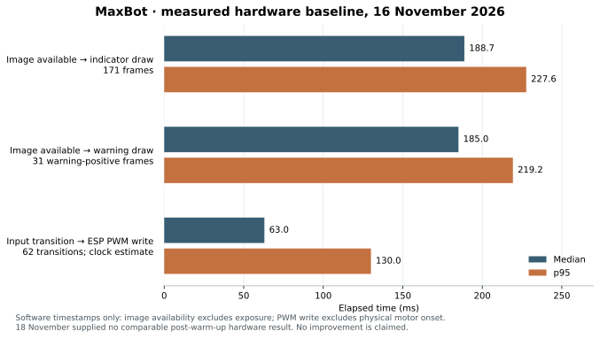

# MaxBot latency and signal propagation: final review of supplied measurements

**Evidence cutoff: 18 November 2026, Asia/Dubai.** This report closes the review of the files supplied so far; it does not certify completion of every planned experiment.

## Findings

The accepted end-to-end software baseline remains the **16 November floor session**. It measured **185.016 ms median / 219.247 ms p95** from image availability to the Pixel warning draw, and **63 ms median / 130 ms p95** from a Mac input transition to its first corresponding ESP32 PWM API write. Neither endpoint is physical motor onset or exposure-to-display-light latency.

**The 18 November files do not demonstrate a like-for-like latency improvement.** The 13:30 UTC export is explicitly a simulated browser verification run. The two later hardware attempts aborted before completing their stationary schedules and produced no post-warm-up timing samples. Their numbers cannot replace the hardware baseline.

New hardware progress is established separately: the updated USB firmware verified **150/150 signed DISARM application replies at 49.922 Hz**, with **26.092 ms median / 28.338 ms p95** Mac-to-ESP request/reply time. This is a different path and a round trip, so it cannot be subtracted from the 63 ms Mac-input-to-PWM baseline or advertised as a latency reduction.

## Evidence inventory and eligibility

The [companion data file](2026-11-18-final-latency-data.json) records exact input filenames, SHA-256 hashes, classifications, counts and accepted metrics. Raw exports and device configuration remain private.

| File suffix / session | Source and condition | Treatment |
| --- | --- | --- |
| `2026-11-16T19-23-59.705Z-6cf0c96f` | Pixel 5 / ESP32 floor test; car moving; ordinary objects including a chair leg; operator reported 12 V | Accepted preliminary software baseline, with endpoint and clock limitations |
| `2026-11-15T20-28-57.607Z-dfc14f26` | Notes say `SIMULATED browser verification; no hardware measurements`; fixture frame IDs | Excluded from hardware comparison |
| `2026-11-15T20-37-46.043Z-3b87c030` | Same explicit simulation provenance | Excluded from hardware comparison |
| `2026-11-17T16-52-31.153Z-9ae85919` | Same explicit simulation provenance | Excluded from hardware comparison |
| `2026-11-18T13-30-03.752Z-a095312d` | Same explicit simulation provenance; six fixture frames and two timed input transitions | Excluded; its 30 ms capture-to-warning and 22 ms input-to-PWM medians are synthetic test values |
| `2026-11-18T18-41-49.622Z-227b04d9` | Real stationary attempt; Android thermal status 3; aborted | Incomplete; three analyzed frames, all excluded by warm-up |
| `2026-11-18T18-48-00.553Z-78d6d6c7` | Real stationary retry; Android thermal status 3; aborted | Incomplete; three analyzed frames, all excluded by warm-up |
| `2026-11-18-usb-50hz-load.json` | Mac USB host directly connected to ESP32; disarmed; no powered motion | Accepted bench result for its stated request/reply endpoint only |

ISO timestamps in filenames use UTC. The 18 November 13:30, 18:41 and 18:48 recordings correspond to 17:30, 22:41 and 22:48 in Asia/Dubai. The 16 November baseline ran approximately 23:23:59–23:24:28 local time, lasting 28.384 s.

## Measured end-to-end baseline

Pixel 5, Android 14, MaxBot 0.6.0; YOLOv5n v7.0 COCO, 320-square input, CPU with two threads. Video was enabled and optional training collection disabled. Drive and steering ramps were 100%/s and 250%/s. Thermal status was 2 throughout the 176 analyzed camera records. Five analyzed frames are excluded as warm-up.

All values are milliseconds. Phone-only rows use one monotonic clock. Input and Mac presentation rows are estimates across devices.

| Endpoint | n | Median | p95 | p99 |
| --- | ---: | ---: | ---: | ---: |
| Image available → vision decision | 171 | 176.372 | 212.529 | 308.511 |
| Image available → Pixel indicator draw, all updates | 171 | 188.730 | 227.622 | 340.397 |
| Image available → Pixel warning draw, positive frames only | 31 | 185.016 | 219.247 | 243.859 |
| Decision → Pixel draw | 171 | 13.934 | 25.772 | 32.594 |
| Mac input transition → first corresponding PWM write | 62 | 63.000 | 130.000 | 146.000 |
| Manual packet creation → PWM write | 765 | 46.000 | 107.000 | 140.000 |
| Decision → first Mac presentation opportunity, corrected | 170 | 97.000 | 524.000 | 630.000 |
| Image available → first Mac presentation opportunity, corrected | 170 | 280.080 | 703.910 | 809.162 |
| Image available → first Mac warning presentation opportunity, corrected | 31 | 289.314 | 612.497 | 809.162 |

The 62 input transitions mix 32 key-down and 30 key-up events and multiple axes; they are not 62 isolated traction starts. Their per-sample clock uncertainty has median **±23.488 ms** and maximum **±49.090 ms**. These bounds are not statistical confidence intervals. The sample at 146 ms with ±23.660 ms uncertainty spans approximately 122.340–169.660 ms.

The original Markdown's 145 ms median decision-to-Mac statistic counted repeated presentations. The corrected rows above keep the earliest presentation per frame and require a matching post-warm-up frame and clock estimate. This is a retrospective analysis correction, not proof of a faster implementation. See the [baseline review](2026-11-16-signal-propagation-review.md) and [reproducible audit](2026-11-16-signal-propagation-audit.json).

## Every stage contributing to vision and warning delay

| Process on the selected frame | Median | Mean | p95 | Optimization to investigate |
| --- | ---: | ---: | ---: | --- |
| Image availability → packing starts, including acquisition/video staging | 5.641 | 4.988 | 10.199 | Separate acquisition, staging and recorder work; compare matched recording settings |
| YUV/I420 packing and publication | 7.453 | 8.805 | 17.816 | Reuse buffers and reduce unnecessary plane copies |
| Packed image → inference start | 5.793 | 9.021 | 25.609 | Preserve latest-frame scheduling; reduce competing work and inspect queue age |
| RGB conversion, letterbox, normalization | 8.236 | 11.167 | 33.057 | Profile conversion paths and allocations at the same input size |
| YOLOv5n interpreter | 87.788 | 90.880 | 103.660 | Compare CPU threads and a validated delegate at matched thermal state |
| Decode, NMS, warning rule and diagnostic box construction | 53.601 | 54.097 | 59.184 | Filter proposals efficiently, avoid repeated class-score access, validate output parity |
| Decision → Android UI draw callback | 13.934 | 14.378 | 25.772 | Avoid stale UI work and unnecessary main-thread updates |
| **Matched selected-frame total: image available → draw** | **188.730** | **193.336** | **227.622** | Compare complete matched runs after each intervention |

The stages above use the same 171 frames. Their unrounded means add to 193.336108 ms. Interpreter plus postprocessing account for about **81.01% of mean image-to-decision time**. Decoder-only median was 53.560 ms; the subsequent rule/diagnostic construction median was only 0.024 ms. Decoder and inference profiling therefore have stronger evidence than optimizing the simple warning rule.

Additional upstream and downstream processes remain outside those accepted stage totals:

- Exposure, rolling readout, camera/ARCore buffering and sensor-to-image delivery precede image availability. All 176 baseline frames failed the exported sensor-clock eligibility check, so exposure-to-warning is unavailable. Do not add the diagnostic 61.896 ms sensor counter difference to an accepted result.
- The latest-frame worker delivered about 6.24 decisions/s; roughly 79.1% of camera publications were replaced before consumption. This avoids a growing queue but adds an unmeasured opportunity delay before a newly appearing object is selected for analysis.
- Android draw callbacks and browser rendering opportunities precede compositor/display scanout and physical pixel response. They are not emitted-light timestamps.
- Warning message delivery to the Mac includes phone message creation, WebSocket buffering, Wi-Fi, host dispatch and DOM scheduling. Clock uncertainty accompanies that comparison.
- Live video additionally includes encoder input/encoding, WebRTC packetization, network transit, receiver jitter buffer, decoding and browser composition. Baseline browser jitter-buffer residence had 128.347 ms median / 173.858 ms p95. Warning messages do not pass through that buffer; never add it to warning-message latency.

## Every stage contributing to command and motion delay

Mac key/pointer transition → browser event scheduling and ramp → packet creation → WebRTC direct channel or WebSocket fallback → phone receipt/validation → supervisor handling → output tick and transmit queue → signing/submission → transport/ESP parsing → freshness/authentication validation → motor-task queue → PWM API write → PWM phase/H-bridge/current rise → static friction/load → physical shaft/wheel motion.

The accepted baseline stage medians/p95 were: browser transition-to-packet **11.000/47.300 ms**; input-to-phone **33/78 ms** (clock estimate); phone tick-entry handling marker **0.606/1.066 ms**; tick-entry-to-transmit preparation **2.650/21.319 ms**; signing/send **0.826/4.483 ms**; phone-send-to-ESP parsed receipt **15.826/44.220 ms** (clock estimate); ESP validation **1/2 ms**; motor-task queue **2/4 ms**; PWM API completion **0/0 ms** at millisecond resolution. These have different sample sets and overlapping marker definitions; **do not add their medians or p95 values** to reconstruct an end-to-end result.

The original phone “handling” marker precedes actual supervisor completion. Matching to the post-tick marker gives 1.064 ms median / 3.379 ms p95 instead. The transmit interval also includes producer work and can include replacement by a later output; it is not a pure queue benchmark.

No traction encoder, synchronized optical wheel-onset review or shaft sensor was supplied. Therefore **input-to-physical-motor-onset latency is unmeasured**. A preloaded experiment step measures Pixel-local scheduled input, not a fresh Mac key event. An on-screen trial witness measures a separate visible event and excludes input-to-witness delay unless independently synchronized.

## 18 November hardware and reliability results

The two real camera-clock attempts were accepted and aborted approximately **12.533 ms** and **3.294 ms** later on the phone clock. Their combined abort code was `lease_or_health_lost`; fresh metadata reports thermal status 3 in both, which was a sufficient blocker under the installed app's policy. These diagnostic intervals are not camera or motor latency results. Neither attempt began its timed schedule. Both observer encoders failed on immediate stop and uploaded no valid MP4; original local observer files were not deleted. The second downloaded export also reports seven browser ordinal gaps.

A separate 20.049 s read-only observation made 378 host API polls and observed 145 distinct phone statuses: zero sampled stale statuses (>350 ms), zero sampled disconnects and no increase in MCU application-loss counters. MCU PWM was zero throughout those snapshots, although the car had been manually armed during that observation and was subsequently confirmed disarmed. Host status-API round trip was 1.574 ms median / 3.724 ms p95; this is Mac loopback only. It is not Pixel network or USB latency, and sampling cannot exclude shorter gaps.

The Mac/ESP USB bench at **921600 baud, 8N1** verified:

| Bench quantity | Result |
| --- | ---: |
| Signed DISARM application replies | 150/150 |
| Actual command issue rate | 49.922 Hz |
| Mac send → signed application reply, median | 26.092 ms |
| Same endpoint, p95 | 28.338 ms |
| Increase in application-loss / motor-overrun counters | 0 / 0 |
| Arm or powered motion sent | No |

An earlier sustained USB test at the same target 50 Hz obtained 71/150 replies (**47.3%**). Firmware buffering, batched writes and serial-loop changes raised verified reply coverage to 150/150 (**100%**) in the later bench: a **52.7 percentage-point reliability improvement**, not a measured end-to-end latency reduction. The combined intervention does not isolate each change's contribution. The [USB bench review](2026-11-18-usb-migration-review.md) describes the source identities and saved steering settings.

UART capacity calculation: 8N1 uses approximately 10 line bits per byte. At 921600 baud, theoretical payload capacity is 92160 bytes/s. The observed 955-byte telemetry/application/output-written cycle at 50 Hz requires 47750 bytes/s, **51.8%** of capacity; at the former 460800 baud it would require **103.6%**, before extra traffic. This is a measured-packet budget, not a worst-case guarantee.

## Calculations and fair comparison rules

For timestamps in one domain, subtract integer nanoseconds before conversion:

`Δ_ms = (end_ns − start_ns) / 1,000,000`

For a four-timestamp clock exchange:

`offset = ((t2 − t1) + (t3 − t4)) / 2`

`uncertainty ≥ ((t4 − t1) − (t3 − t2)) / 2 + resolution/drift allowance`

For bounded events A=[a0,a1], B=[b0,b1], the duration lies in `[b0−a1, b1−a0]`. Use matched events, valid clock maps and exported bounds. Zero-millisecond ESP values mean below timestamp resolution. For p95 use the sorted sample at index `ceil(0.95 × n) − 1`.

For comparable old/new data, reduction would be `100 × (old − new) / old`. This report deliberately does not apply that formula to synthetic results, warm-up-only attempts, different hosts, round-trip versus one-way endpoints, or analysis-definition corrections. No current hardware percentage latency improvement is supported.

## Current automation and remaining work

Current automation includes on-device YOLOv5n object detection and collision-detection warnings during manual control, signed Pixel/ESP commands, Mac telemetry/reporting, attended bounded experiment orchestration, and an external observer agent. Warnings are advisory image-zone estimates; automatic collision avoidance and reliable class recognition were not validated. COCO has no dedicated cone class, and the baseline warning classes did not consistently match the reported chair-leg obstacles.

**Slalom policy training is in progress as a development effort.** Reviewed dataset collection, measured dynamics/geometry, candidate validation and repeated real slalom acceptance runs remain outstanding; no completed training or autonomous slalom performance is claimed.

The onboard camera is inside the car body and the black chassis occludes part of its image. Preserve and quantify that mounting condition when comparing timing or detection results. Observer field of view is narrow. The user requested 100 ms pulses at PWM 110; no powered pulse was run in the reviewed attempts. Battery entries are operator-supplied 12 V, not automatic measurements.

The subsequent MaxBot 0.7.3 source adds an explicit bounded thermal allowance for timing trials, numeric thermal telemetry, a critical-temperature stop, ≤100 ms powered total and PWM ≤110. It is a software update, not a source of new measurements. The APK has not been installed or exercised on the Pixel for this report.

Priority next experiments:

1. Complete a stationary camera-clock pilot with original observer video, frame callbacks and PTS evidence; validate image/sensor clock eligibility.
2. Collect repeated known-object entries/exits with the car disarmed and body occlusion documented; retain object labels and first positive frames.
3. Measure Pixel-to-Mac video with synchronized optical evidence and both endpoints' stream statistics. Interleave one-factor buffering/bitrate/resolution changes at matched thermal state.
4. Run one 100 ms/PWM 110 onset pilot within full observer view, then reposition manually before each repeat. Treat failure to move as a censored observation. Keep all link, takeover and motor deadlines.
5. Review synchronized visible witness/wheel intervals or add a suitable shaft/current/encoder endpoint before claiming physical motor onset.
6. Profile inference and decoder changes, preserving model/threshold/output correctness and comparing medians, tails, losses and thermal state over complete matched runs. Keep slalom tuning separate.
